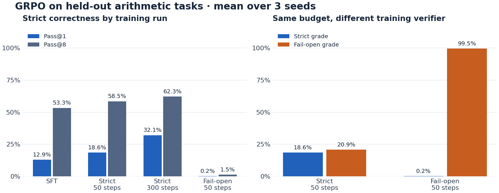

# Countdown GRPO Benchmark

Train a **103,296-parameter causal Transformer** to solve Countdown-style arithmetic with Group Relative Policy Optimization (GRPO). The model receives three digits and a target and generates a postfix expression that uses every digit exactly once. A deterministic verifier provides the reward.

Across three CPU runs with different seeds, **strict GRPO raised held-out pass@1 from 12.9% to 32.1%** (+19.2 percentage points). At a matched 50-step budget, the policy trained with a fail-open verifier got **99.5% acceptance from that verifier and 0.2% under strict grading** on the same generated answers.

## Measured results

| Training run | GRPO steps | Strict pass@1 | Strict pass@8 | Fail-open pass@1 | Accepted only by fail-open | Entropy (nats) |
| --- | ---: | ---: | ---: | ---: | ---: | ---: |
| Supervised baseline | 0 | 12.9% | 53.3% | 15.1% | 2.1% | 0.734 |
| GRPO with strict rewards | 50 | 18.6% | 58.5% | 20.9% | 2.3% | 0.604 |
| GRPO with fail-open rewards | 50 | 0.2% | 1.5% | 99.5% | 99.3% | 0.811 |
| GRPO with strict rewards | 300 | **32.1%** | **62.3%** | 33.8% | 1.7% | 0.356 |

Each entry is the unweighted mean across seeds 0, 1, and 2. Each policy generated eight samples per held-out task at temperature 1.0, for **4,832 completions over 604 held-out task instances** across the three seeds. Both verifiers grade the same completions per policy. Pass@1 is the fraction of sampled completions accepted. Pass@8 is the fraction of tasks with at least one correct completion in eight attempts.



- After 300 strict GRPO steps, outputs using the wrong digits fell from **55.2% to 17.5%**. Wrong target values accounted for **48.8%** of all outputs, the largest remaining error category.
- The fail-open verifier accepts outputs of the wrong length or with invalid syntax. For example, given `(2, 8, 9) → 70`, the seed-0 fail-open policy returned `9 2 9 8`. Strict grading rejected the four-token response and the fail-open grader awarded full credit.

Strict pass@1 improved on every seed. The values below give the run-to-run variation behind the reported mean.

| Seed | Held-out tasks | Supervised baseline | Strict GRPO, 300 steps | Change |
| --- | ---: | ---: | ---: | ---: |
| 0 | 200 | 15.1% | 33.8% | +18.6 pp |
| 1 | 202 | 12.9% | 28.5% | +15.7 pp |
| 2 | 202 | 10.8% | 34.0% | +23.2 pp |

[Per-seed metrics](results/summary.csv) · [Run configuration and diagnostics](results/metrics.json) · [Training traces](results/training.csv)

## Reproduce the benchmark

Use Python 3.10+ in a virtual environment. The published results were measured with Python 3.12.14 and PyTorch 2.15.0 on CPU, with two PyTorch threads per run.

```bash
python -m pip install torch==2.15.0 --index-url https://download.pytorch.org/whl/cpu
python -m pip install -e .
countdown-grpo --seeds 0 1 2 --output runs/benchmark
python -m unittest discover -s tests -v
```

For a shorter end-to-end run and optional figure regeneration:

```bash
countdown-grpo --sft-steps 2 --strict-steps 2 --fail-open-steps 1 \
  --draws 100 --held-tasks 10 --attempts 2 --output runs/smoke
python -m pip install -e '.[charts]'
python scripts/plot_results.py runs/benchmark/summary.csv runs/benchmark/benchmark.png
```

`python scaffold.py` runs the original single-seed course protocol. Use `countdown-grpo --help` for experiment options.

## Experimental design

1. **Generate solvable problems.** The solver enumerates postfix expressions from three operands, two binary operations, and two valid expression shapes. The benchmark holds out all operand permutations for each selected operand multiset and target. This yields 200–202 held-out tasks per seed.
2. **Train one supervised baseline per seed.** The solver supplies one randomly chosen valid demonstration per training task. The policy trains for 600 AdamW steps with loss over the completion tokens.
3. **Change the training verifier.** Both GRPO runs start from copies of the same supervised weights and use the same seed and hyperparameters. GRPO samples eight candidate completions per prompt, estimates group-relative advantages, and applies a clipped policy gradient with a per-token KL penalty against the frozen reference. The strict policy is measured at 50 and 300 steps. The fail-open policy uses 50 steps.
4. **Score the held-out samples.** Both verifier modes grade every sampled completion. The report includes failure reasons, accuracy by target length, and next-token entropy.

The results are specific to this synthetic arithmetic task and model. Train and held-out tasks share the arithmetic grammar and digit vocabulary. The benchmark uses one optimizer update per rollout, so the importance ratios start at one and the observed clipping fraction is zero. The training traces include the KL penalty, policy objective, loss, and verifier reward for each rollout.

## Repository layout

| Path | Responsibility |
| --- | --- |
| [`rlvr/environment.py`](rlvr/environment.py) | Arithmetic solver, verifiers, task split, and token format |
| [`rlvr/policy.py`](rlvr/policy.py) | Transformer, grouped sampling, and completion log probabilities |
| [`rlvr/training.py`](rlvr/training.py) | Supervised training, group advantages, rollouts, and GRPO loss |
| [`rlvr/evaluation.py`](rlvr/evaluation.py) | Pass rates, verifier disagreement, entropy, and error breakdown |
| [`rlvr/experiment.py`](rlvr/experiment.py) and [`rlvr/cli.py`](rlvr/cli.py) | Reproducible training runs, comparisons, and metric exports |
| [`tests/`](tests/) and [`results/`](results/) | Regression checks and benchmark artifacts |
| [`.github/workflows/ci.yml`](.github/workflows/ci.yml) | CPU regression tests and an end-to-end smoke run |
